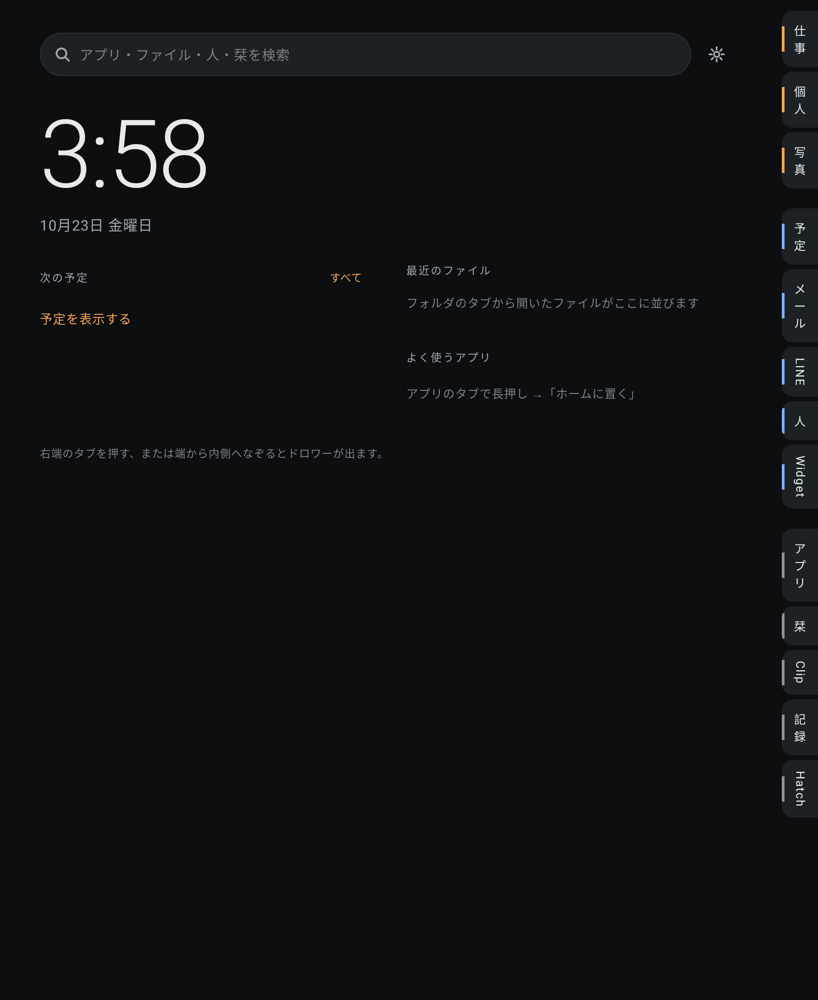
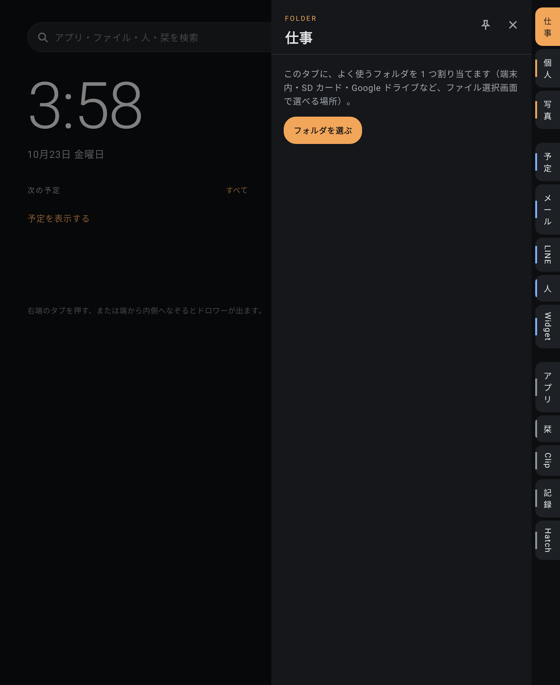
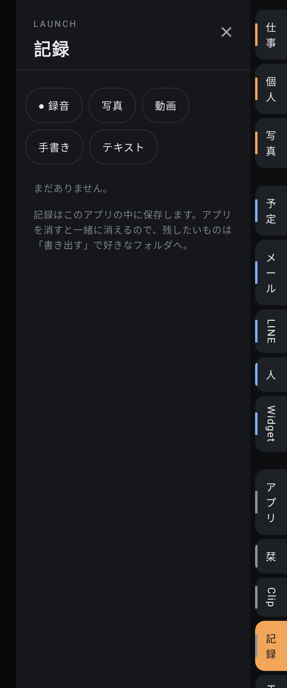

# Theta Home Hatch

アイコンを並べない Android のホームアプリ。画面の端に並んだタブを押すと、割り当てたフォルダ、予定、メール、LINE、ウィジェット、アプリ、栞、Clip、記録、Theta Hatch シリーズがスライドインします。DeskHatch の「バー＋ドロワー」を、スマホとタブレットのホームに持ってくる構想です。

- 版：**0.2.0-alpha（versionCode 2）**／package `jp.yaegaki.theta.home`／Android 10（API 29）以上
- 対象：Galaxy Z Fold5（カバー・メイン）、Alldocube iPlay 60 / 80 Pro 系タブレット、Unihertz Titan 2（物理キーボード）
- **実機での確認はまだです。** 画面は JVM 上で描いて確かめています（[`docs/screenshots/`](docs/screenshots)）。
- コンセプトのモックアップ：<https://claude.ai/artifact/TbT9aQRtJ4RVXBCX2PT5CA>（非公開。共有メニューで共有するまでは本人だけが開けます）

| Fold5 メイン | フォルダのドロワー | Hatch | カバー画面・記録 |
| --- | --- | --- | --- |
|  |  |  |  |

## できること

| タブ | 内容 |
| --- | --- |
| フォルダ（仕事・個人・写真、追加可） | タブ 1 つにフォルダ 1 つ。端末内・SD・Google ドライブなど、ファイル選択画面で選べる場所。ドロワーの中で階層を辿り、開く・共有・アプリを選んで開く。開いたファイルはホームの「最近のファイル」へ |
| 予定 | 端末のカレンダー（Google カレンダーと同期しているもの）から 7 日分。日付で切り替え、押すと予定を開く |
| メール・LINE | 通知へのアクセスを許可すると、届いた通知を並べ、押すとその通知と同じ画面（LINE なら該当トーク）を開く。LINE には公開 API がないためこの方式。通知の内容は端末内のメモリだけで扱う |
| 人 | 連絡先。スター付きが先頭とホームに。電話・メール・LINE・詳細 |
| Widget | ほかのアプリのウィジェットをドロワーにしまう（割り当ての許可と、必要ならウィジェット自身の設定画面を通る）。並べ替え・外す |
| アプリ | アイコンなしの文字の一覧。絞り込み、長押しで「ホームに置く」・アプリ情報 |
| 栞 | URL の登録。Clip に入った URL からも追加できる |
| Clip | 共有メニューの「Clip に保存」で、テキスト・URL・ファイルを一時保存 |
| 記録 | 録音（通知に停止ボタン）・写真・動画・手書き（S ペン優先・筆圧・消しゴム）・テキスト。アプリ内に保存し、「書き出す」で好きなフォルダへ |
| Hatch | シリーズの起動。未導入・更新ありなら GitHub Releases から取得 → SHA-256 照合 → インストール確認画面へ |

画面の幅で並べ方が変わります（機種名では決めません）。

- 600dp 未満（Fold5 カバー、Titan）：ドロワーは重ねて表示。
- 690dp 以上（Fold5 メイン）：ドロワーをピン留めすると、ホームの横に並べて出しっぱなしにできる。
- 1180dp 以上（横向きタブレット）：2 枚まで並べられる。
- 物理キーボード：Alt＋1〜9 でフォルダのタブ、Alt＋C 予定・M メール・L LINE・P 人・W Widget・A アプリ・B 栞・X Clip・R 記録・H Hatch。ホームで文字を打つとすぐ検索、Esc で閉じる。

設定（ホーム右上の歯車）：既定のホームにする、タブの名前・並び順・追加・削除、タブを左端に、グレーの配色、アイコンのモノクロ表示。

## 入れ方

1. APK を端末で開いてインストール（「提供元不明のアプリ」の許可が必要）。
2. まず普通のアプリとして開き、フォルダのタブにフォルダを割り当てて動きを確かめる。
3. 設定 →「既定のホームにする」。元に戻すときは端末の 設定 → アプリ → 標準アプリ → ホームアプリ。

ChatGPT で作った 0.1.0-alpha（`com.theta.homehatch`）とは別のアプリとして入ります。不要ならそちらはアンインストールしてください。

## ビルド

Android Studio でこのフォルダを開くか、`./gradlew :app:assembleDebug`。

- テスト・lint・画面の見本：`./gradlew :app:testDebugUnitTest :app:lintDebug`（見本は `app/build/screenshots/`）
- リリース署名：リポジトリの外に置いた鍵を `keystore.properties`（gitignore 済み）か環境変数 `HOME_KEYSTORE` などで渡して `./gradlew :app:assembleRelease`。**鍵と鍵の情報はコミットしない。**

## 構成

| 場所 | 内容 |
| --- | --- |
| `app/src/main/java/jp/yaegaki/theta/home/` | `HomeModel`（状態）、`MainActivity`（ホーム・キーボード）、`ShareToClipActivity` |
| `…/data/` | 設定の保存、フォルダ（SAF）、予定、連絡先、アプリ一覧 |
| `…/ui/` | 端のタブ、ドロワー、ホーム、設定（Jetpack Compose） |
| `…/capture/` | 録音サービス、手書きの保存 |
| `…/notify/` | LINE・メールの通知の受け取り |
| `…/hatch/` | Hatch の一覧、GitHub Releases からの取得とインストール |
| `…/widgets/` | ウィジェットのホスト |
| `docs/` | [経緯と ChatGPT 版との比較・次の一歩](docs/PLAN.md)、画面の見本 |
| `reference/` | ChatGPT 版 0.1.0-alpha のソース・調査メモ・モックアップ（参照用、そのまま収録） |
