# Theta Home Hatch

[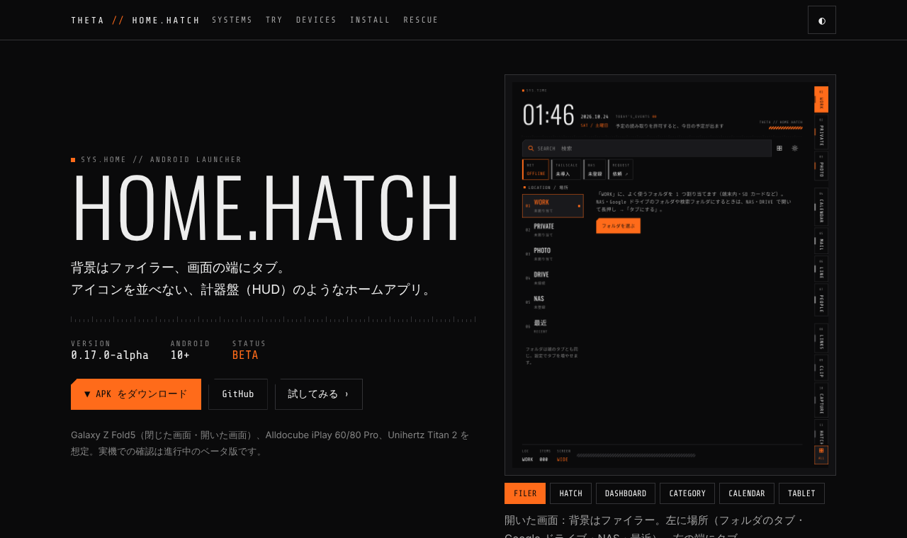](https://kiwiman0706-beep.github.io/Theta.Home.Hatch/)

**▶ [機能紹介（インタラクティブ）](https://kiwiman0706-beep.github.io/Theta.Home.Hatch/)**　·　**▼ [APK をダウンロード](https://github.com/kiwiman0706-beep/Theta.Home.Hatch/releases)**　·　[変更履歴](CHANGELOG.md)

**背景（デスクトップ）にファイラーを置き、画面の端のタブでドロワーやウィジェットを切り替える** Android のホームアプリ。
スマホはアプリには行きやすいのにファイルには行きにくいので、PC のデスクトップのように「ファイルの置き場」をホームにする。ただ散らかして置くのではなく、ファイラーとして置く。

- **ダウンロード：[Releases](https://github.com/kiwiman0706-beep/Theta.Home.Hatch/releases)**（`ThetaHomeHatch-<版>.apk`）
- 版：**0.20.0-alpha（versionCode 24）**／package `jp.yaegaki.theta.home`／Android 10（API 29）以上
- 対象：Galaxy Z Fold5（カバー・メイン）、Alldocube iPlay 60 / 80 Pro 系、Unihertz Titan 2（物理キーボード）
- **実機での確認はまだです。** 画面は JVM 上で描いて確かめています（[`docs/screenshots/`](docs/screenshots)）。

| Fold5 メイン：背景のファイラー | Hatch のドロワー | カバー画面 | タブレット |
| --- | --- | --- | --- |
| 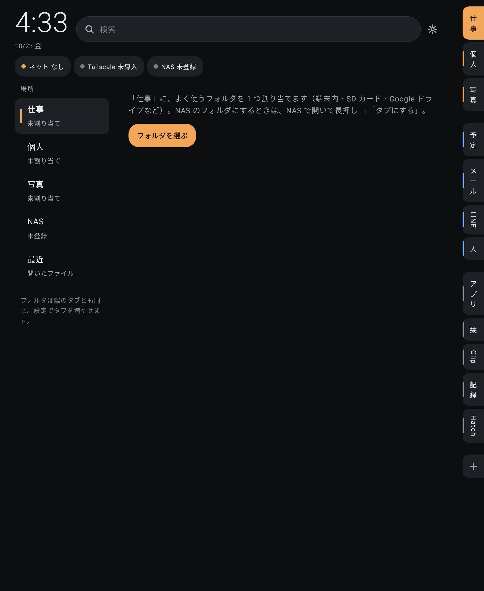 | 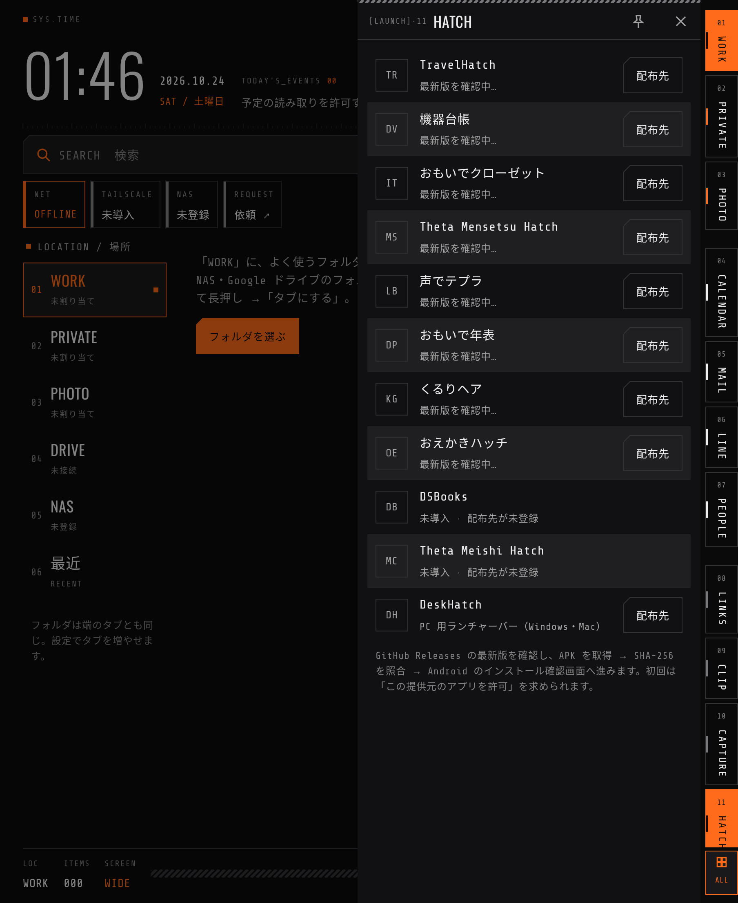 | 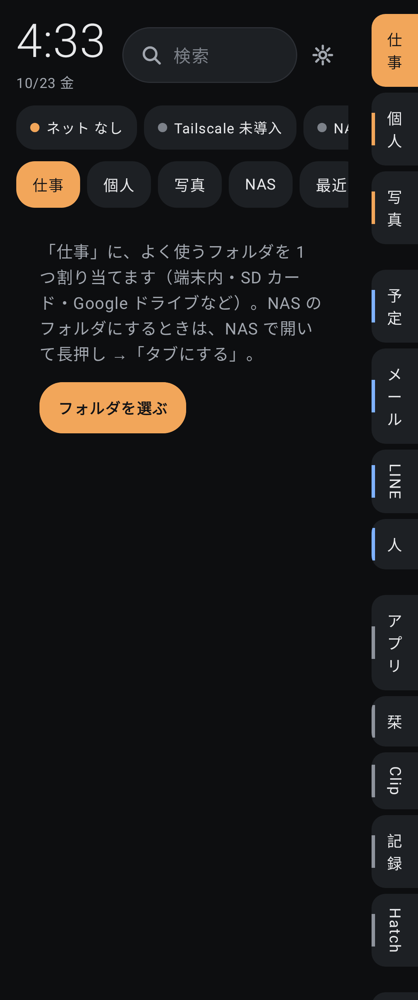 | 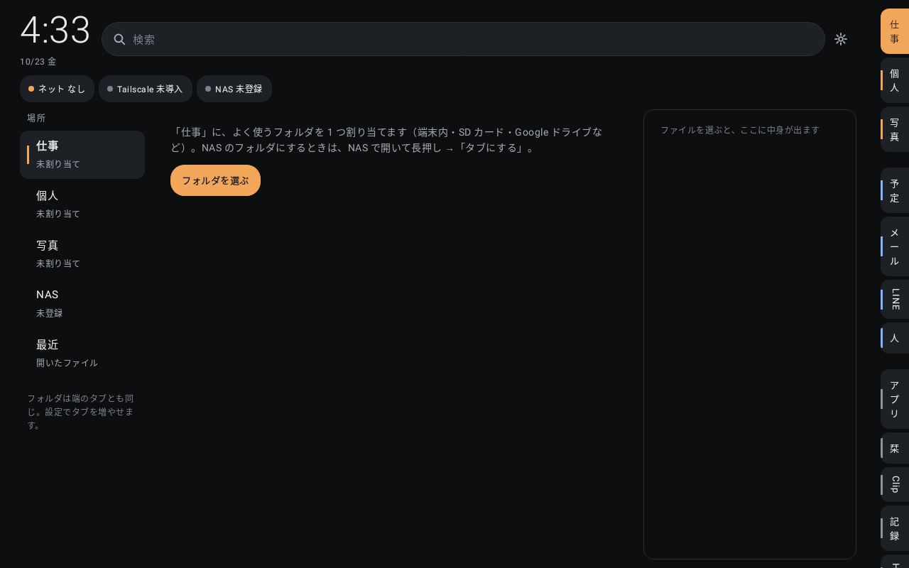 |

## 狭い画面のダッシュボード・カレンダー

狭い画面（幅 600dp 未満：閉じた Fold5・Titan）の背景は、今日の予定・天気（Open-Meteo）・つながり・ファイル・端末のダッシュボード。ファイラーは「FILES」の場所を押すと開く（フォルダのタブはドロワーで開く）。カレンダーのドロワーは月（日曜始まり、予定は全部）・週・日。

| ダッシュボード | 月 | 日 |
| --- | --- | --- |
| 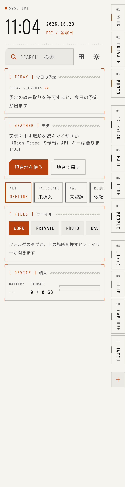 | 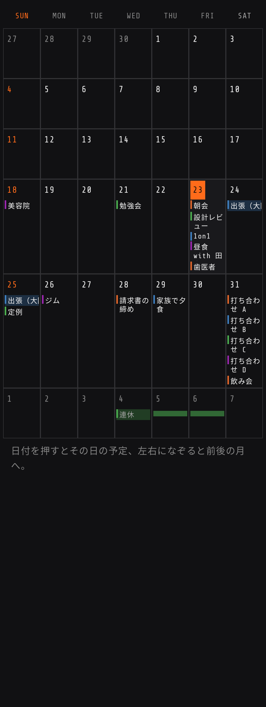 | 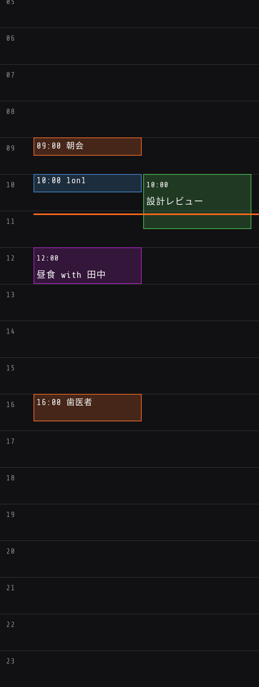 |

## エッジ（ほかのアプリの上で端からタブ）

設定 → EDGE をオンにすると、どのアプリを使っていても、画面の端の細い線を内側へなぞる（または押す）だけでカテゴリーのタブとアプリを引き出せます。HOME でホーム全体へ、外側を押すか「戻る」で閉じます。左右の端と高さを選べます。「ほかのアプリの上に表示」の許可と、常駐の通知が要ります。ホームキーの動き（押すとホーム全体）は Android の決まりなので変えていません。

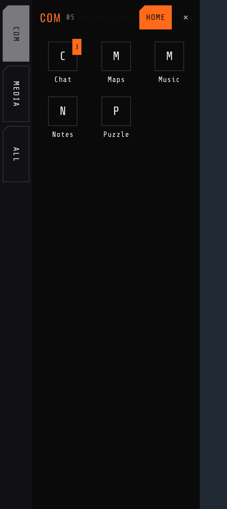 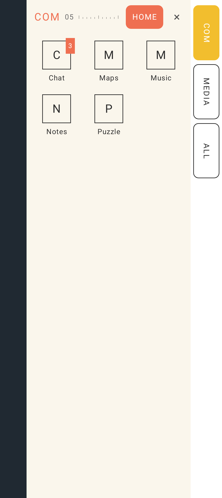

## 見た目

計器盤（HUD）風：黒地にオレンジ 1 色、細い線、四角い角。見出し・時計は Oswald、ラベル・数字は等幅の Share Tech Mono（同梱、SIL Open Font License、[docs/licenses](docs/licenses)）。日本語は端末の書体。テーマはダーク・ライト・**POP（カラフル）**・端末に合わせるから選べる（設定 → THEME）。POP はクリームの地にコーラル・イエロー・ミント、角丸と影、ゴシック体。

## 画面の構成

- **背景＝ファイラー**（開いた画面）：上に時計・次の予定・検索、ネットワーク／Tailscale／NAS の状態。下は左の「場所」で、最近使ったファイルか、決めたフォルダ（フォルダのタブ・NAS・ドライブ）を切り替えて出す。幅 860dp 以上では選んだファイルの中身（画像・文字）を右に出す。
- **端のタブ**
  - フォルダのタブ（仕事・個人・写真、追加可）：押すと**ドロワーの中にフォルダの中身**。端末のフォルダ（SAF）・NAS・ドライブのフォルダを割り当てる。場所はタブごとに覚え、戻るで上のフォルダへ。
  - 予定・メール・LINE・人・アプリ・栞・Clip・記録・Hatch：**ファイラーの上にスライドイン**するドロワー。
  - WEB：決めた URL のページをタブの中に（リンクもタブの中で、戻るでページを戻る）。FILE：決めた画像・PDF をタブの中に（画像は指で拡大、PDF は縦に並べる）。
  - ウィジェット：1 つのタブに**何個でも縦に**並べられる（見出しの歯車で編集・足す）。パネルは中身の高さだけ。下の「＋」で足す。角をなぞって大きさを変えられ、ドロワーの幅もウィジェットに合わせる。
- **タブは閉じた画面と開いた画面で共通**。ドロワーの幅（内側の端の取っ手をなぞる、2 回押すと元に戻る）とウィジェットの大きさだけ、画面ごとに覚える。タブを長押し →「閉じた画面だけに出す／開いた画面だけに出す」もできる（隠したタブは「＋」から戻せる）。
- **どのタブにもアプリ・ショートカットを置ける**：タブを長押し →「アプリ・ショートカットを置く」。ドロワーの上に並ぶ。
- タブの追加：端のタブの下の「＋」から、ウィジェット・アプリのカテゴリー・フォルダ・WEB・FILE・ドロワー。**長押し→ドラッグ**で並べ替え、動かさずに離すとメニュー（上へ・下へ・名前・アプリを置く・出す画面・幅・外す）。アプリのアイコンも長押し→ドラッグで並べ替え（カテゴリーごとに覚える）。
- アプリのショートカット（LINE のトークルームなど）もタブに置ける：アプリの長押し →「ショートカット」、または各アプリの「ホーム画面に追加」（置くタブを選ぶ）。カテゴリーのタブは、長押し →「ショートカットを別の段に」でアプリと分けて並べられる。

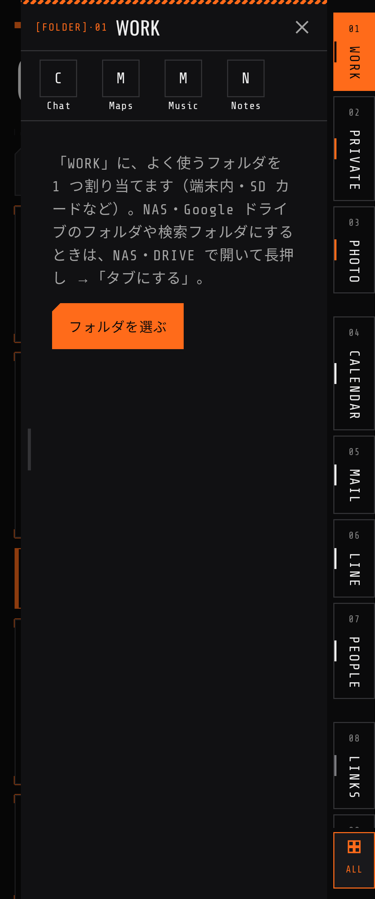 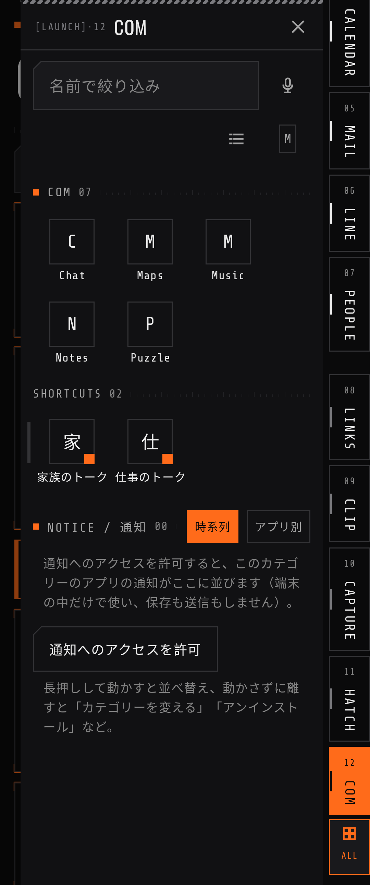 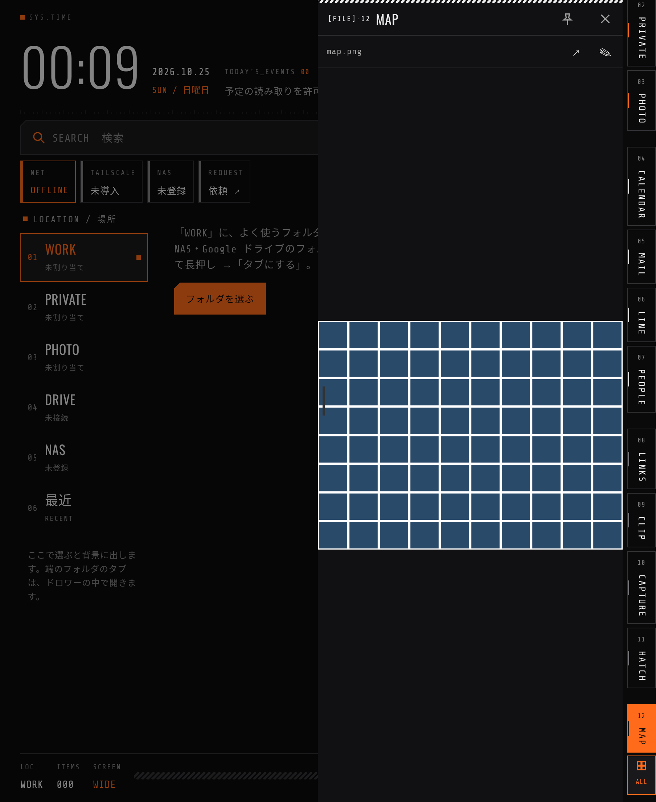 
- アプリの一覧は端のタブのいちばん下に固定の「START（ALL）」か、検索の横のボタン（Alt＋A）。仕分けたカテゴリーは、それぞれタブにもできる（アイコンのグリッド）。
- ピン留め：Fold5 メイン（690dp 以上）で 1 枚、横向きタブレット（1180dp 以上）で 2 枚、ドロワーを横に並べて出しておける。

## ファイラーの見せ方

一覧の右上で **一覧／グリッド** と **大きさ（S・M・L・XL）** を切り替える。写真・動画・PDF はサムネイル（NAS・Google ドライブも）。見せ方は**フォルダごとに覚え**、設定の無いフォルダは親フォルダの見せ方を引き継ぐ。写真・動画が多いフォルダは初めからグリッド。

| グリッド | 一覧＋サムネイル（ライト） |
| --- | --- |
|  | 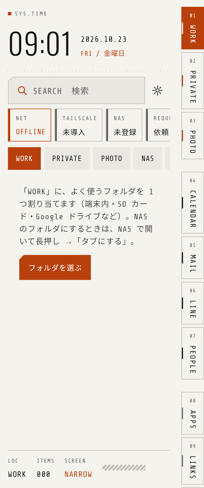 |

## Google ドライブ

Drive API でつなぐ（読み取りのみ、`drive.readonly`）。ファイラーの「DRIVE」から、マイドライブ・共有アイテム・共有ドライブ・スター付きを辿る。開く・共有は端末へ取得してから（Google ドキュメントなどはリンクで開く）。フォルダを長押し →「〇〇のタブにする」。

### 検索フォルダ（仮想フォルダ）

条件を保存して、合うファイルをフォルダのように出す（Google ドライブと NAS）。ドライブ・NAS の入口の「＋ 検索フォルダを作る」か、フォルダを長押し →「この中の検索フォルダを作る」。条件は種類・ファイル名・更新した時期・場所、ドライブは本文・スター付き・共有されたものも。端のタブにも割り当てられる。ドライブには初めから RECENT 7D・PDF・PHOTOS・OFFICE がある。

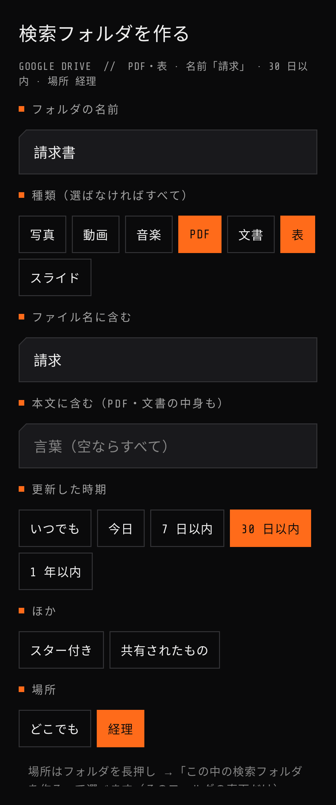

### 初回の登録

初回だけ、自分の Google Cloud プロジェクトにこのアプリを登録する（設定 →「Google ドライブにつなぐ」に手順とリンク）：

1. プロジェクトを作る
2. Drive API を有効にする
3. Google Auth Platform：アプリ名・メール、対象は「外部」、テストユーザーに自分
4. クライアント（Android）を作る：パッケージ名 `jp.yaegaki.theta.home` と、画面に出る署名の SHA-1
5. アプリで「Google でログイン」

公開ステータスが「テスト」のままだと 1 週間ほどでログインし直しになることがある（「本番環境」にすれば避けられる。自分だけで使うなら審査は要らない）。

## NAS と Tailscale

DSBooks と同じく、Synology の DSM File Station API でつなぐ（設定 →「NAS を登録」、またはファイラーの NAS）。外出先からは Tailscale 経由のアドレス（100.x.x.x や 〇〇.ts.net）を入れる。

- 状態の表示：ネット（端末の回線）、Tailscale（VPN がオンか・未導入か）、NAS（接続・届かない・ログイン失敗・未登録）。回線が変わったときとアプリに戻ったときに調べ直す。
- つながらないときは理由を分けて案内し、「Tailscale を開く」「再接続」を出す。Tailscale を勝手にオンにはしない。VPN が無いだけで Tailscale がオフとは断定しない。
- NAS の中を辿り、開く・共有のときは端末へ取得してから渡す（取得したものは新しい 30 個だけ残す）。NAS のフォルダを長押し →「〇〇のタブにする」で、フォルダのタブに割り当てられる。
- アドレスは「100.x.x.x」のように方式とポートを省くと `http://…:5000` を補う。https（:5001）の自己署名証明書は、初回に指紋（SHA-256）を見せて信頼してもらい、以後はその 1 枚だけを受け入れる（変わったら警告）。
- 2 段階認証：求められたら 1 回だけコードを入れる。以後はデバイストークンで通る。
- パスワードは端末の鍵（Android Keystore）で暗号化して保存。
- Tailscale 経由の http を通すため、平文の通信を許可している（Tailscale の通信路自体は暗号化されている）。

## アプリの仕分け

アプリが多いときは、アプリのドロワーの「仕分け N」（N は未分類の数）か、設定の「仕分けガイドを開く」から。

1. **カテゴリーを用意**：候補（仕事・連絡・写真・カメラ・音楽・動画・ニュース・地図・移動・お金・買い物・ツール・Hatch・ゲーム・設定・端末）から選び、足りなければ自分で作る。
2. **1 つずつ振り分け**：アプリが 1 つずつ大きく出るので、振り分け先を押すと次へ進む。合うものが無ければ「＋ 新しいカテゴリー」でその場で作る。アプリの申告する種類（ゲーム・地図・写真など）や名前から、おすすめをオレンジの枠で示す。「戻す」「あとで」「ここで終わる」。

アプリのドロワーはカテゴリーごとに並び、上の札で絞り込める。長押しで「カテゴリーを変える」。

| 1. カテゴリーを用意 | 2. 振り分け（ダーク） | 2. 振り分け（ライト） |
| --- | --- | --- |
| 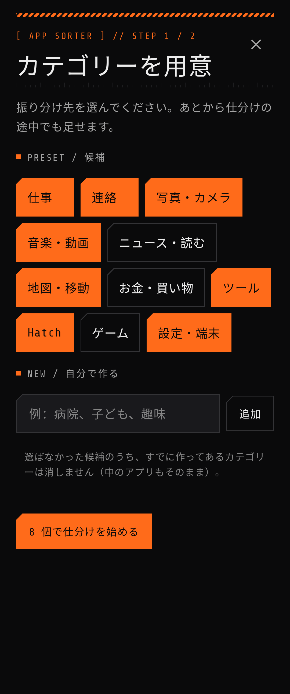 | 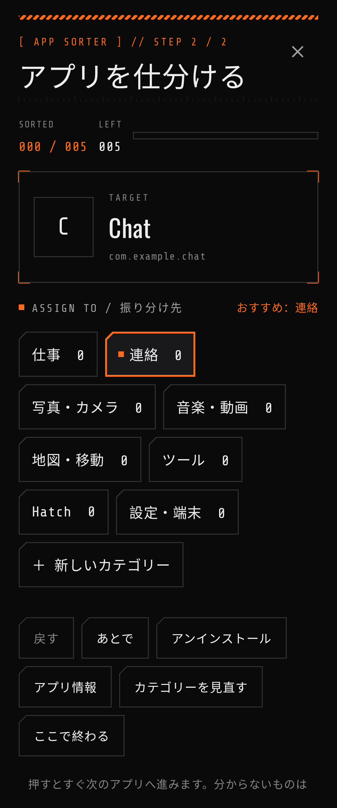 | 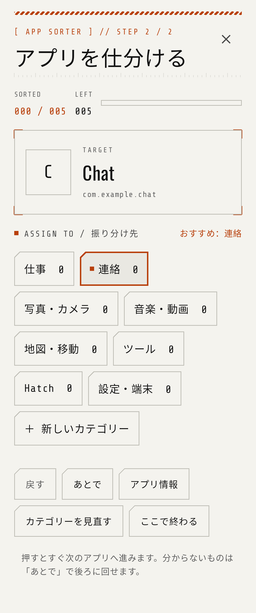 |

## 更新と機能の依頼

- **自動更新**：起動・復帰のとき（1 日 1 回まで）Releases を確かめ、新しい版があれば画面上部に「UPDATE」。押すと取得・照合してインストールへ。設定の「UPDATE」で今すぐ確認・オフ
- **機能を頼む**：画面上部の「REQUEST 依頼 ↗」から、開発の会話（Claude Code）を開く

## アイコンの 3 色

設定の「ICON」で、アプリのアイコンを 3 色（地・基本・アクセント）に塗れる（そのまま・モノクロ・3 色（簡易）・3 色（Gemini））。配色は HUD・オレンジ・塗り・モノクロ・自分で選ぶ。Gemini を使うときは自分の API キーを入れ、「未加工のアプリを Gemini で加工」。アイコンの画像を Google に送り、1 アプリ 1 回課金される。

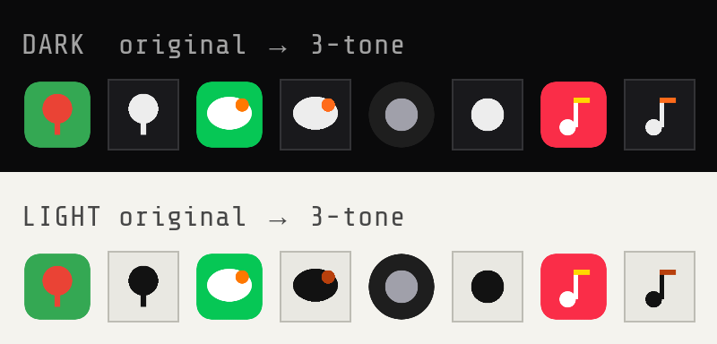

## 引っ越し（設定の書き出し・読み込み）

設定 →「BACKUP」の「設定を書き出す」で 1 つの JSON ファイルに。新しいスマホで「設定を読み込む」と、タブ・テーマ・カテゴリーと仕分け・仕分けの候補・栞・NAS の接続先が戻り、前のスマホにあって今ないアプリが一覧に出る（押すと Play ストア、Hatch シリーズは Hatch のドロワー）。フォルダの許可・ウィジェット・NAS のパスワードは端末ごとなので、やり直しを案内する。

## そのほか

| ドロワー | 内容 |
| --- | --- |
| 予定 | 端末のカレンダーから 7 日分 |
| メール・LINE | 通知へのアクセスを許可すると、届いた通知を並べ、押すとその画面（LINE なら該当トーク）を開く |
| 人 | 連絡先（顔写真つき、スター付きは上に大きく）。電話・メール・LINE・詳細 |
| アプリ | アイコンなしの文字の一覧 |
| 栞・Clip | URL の登録、共有メニューの「Clip に保存」で受け取る一時置き場 |
| 記録 | 録音・写真・動画・手書き（S ペン優先・筆圧・消しゴム）・テキスト |
| Hatch | シリーズの起動、GitHub Releases から取得 → SHA-256 照合 → インストール確認画面へ |

物理キーボード：Alt＋1〜9 でフォルダのタブ、Alt＋C 予定・M メール・L LINE・P 人・A アプリ・B 栞・X Clip・R 記録・H Hatch。ホームで文字を打つとすぐ検索、Esc で閉じる。

## One UI（Galaxy）の見た目も合わせる

設定 → ONE UI で、HUD の壁紙を作って設定し（One UI が壁紙から色を取るので、システムも黒とオレンジ寄りに）、アイコンを 3 色の PNG で書き出せる（Good Lock の Theme Park でアプリごとに選ぶ）。手順は [docs/oneui](docs/oneui/README.md)。

## もしものとき（レスキュー）

ベータ版なので、更新で固まる・落ちることがありえます。

- **通知パネルのクイック設定「ホームのレスキュー」**（設定 → RESCUE の「クイック設定にタイルを足す」、または通知パネルの編集から）。本体と別のプロセスで動くので、ホームが固まっていても開ける
- 起動してすぐ止まるのが続くと、自動でレスキュー画面になる
- レスキュー画面から：別のホームアプリを選ぶ／セーフモード（ウィジェットと天気を止める）／最新版を入れる
- それでもだめなら：通知パネルの歯車 → アプリ → 標準のアプリ → ホームアプリ で選び直す

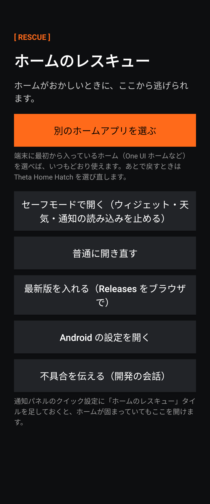

## 入れ方

1. APK を端末で開いてインストール（「提供元不明のアプリ」の許可が必要）。0.2.0 を入れていれば上書きできる（同じ鍵）。
2. まず普通のアプリとして開き、フォルダのタブにフォルダを割り当て、NAS を登録して動きを確かめる。
3. 設定 →「既定のホームにする」。

## リリース

1. 手元で `./gradlew :app:assembleRelease`（鍵は `keystore.properties`）し、APK を `releases/ThetaHomeHatch-<版>.apk` として置く
2. `releases/SHA256SUMS-<x.y.z>.txt`（`sha256sum` の出力）と `docs/release-notes/v<版>.md` を置いてコミット
3. Actions の `release-apk` を「Run workflow」で版（例 `v0.5.0-alpha`）を指定して実行するか、`v<版>` のタグをプッシュする。ハッシュ・署名の証明書・版を確かめてから Release を作り、タグも付ける。`-` 付きの版はプレリリース

## ビルド

`./gradlew :app:assembleDebug`。テスト・lint・画面の見本は `./gradlew :app:testDebugUnitTest :app:lintDebug`（見本は `app/build/screenshots/`）。リリース署名はリポジトリの外の鍵を `keystore.properties`（gitignore 済み）で渡して `./gradlew :app:assembleRelease`。**鍵と鍵の情報はコミットしない。**

## 構成

| 場所 | 内容 |
| --- | --- |
| `app/src/main/java/jp/yaegaki/theta/home/` | `HomeModel`（状態）、`MainActivity`、`ShareToClipActivity` |
| `…/ui/Filer.kt` | 背景のファイラー、状態表示、NAS の登録 |
| `…/ui/HomeRoot.kt` | 端のタブ、ドロワーのスライドイン、ピン留め |
| `…/ui/WidgetDrawer.kt` | 1 タブ 1 ウィジェット、大きさの変更、取り込み |
| `…/nas/` | Synology への接続（`Nas.java`）、パスワードの暗号化（`Secret.java`） |
| `…/data/`・`capture/`・`notify/`・`hatch/`・`widgets/` | フォルダ・予定・連絡先、記録、通知、Hatch、ウィジェットのホスト |
| `docs/PLAN.md` | 経緯と計画 |
| `reference/` | ChatGPT 版 0.1.0-alpha のソース・調査メモ・モックアップ（参照用） |
