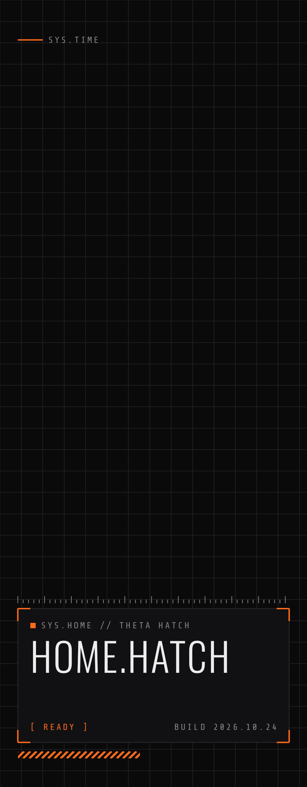
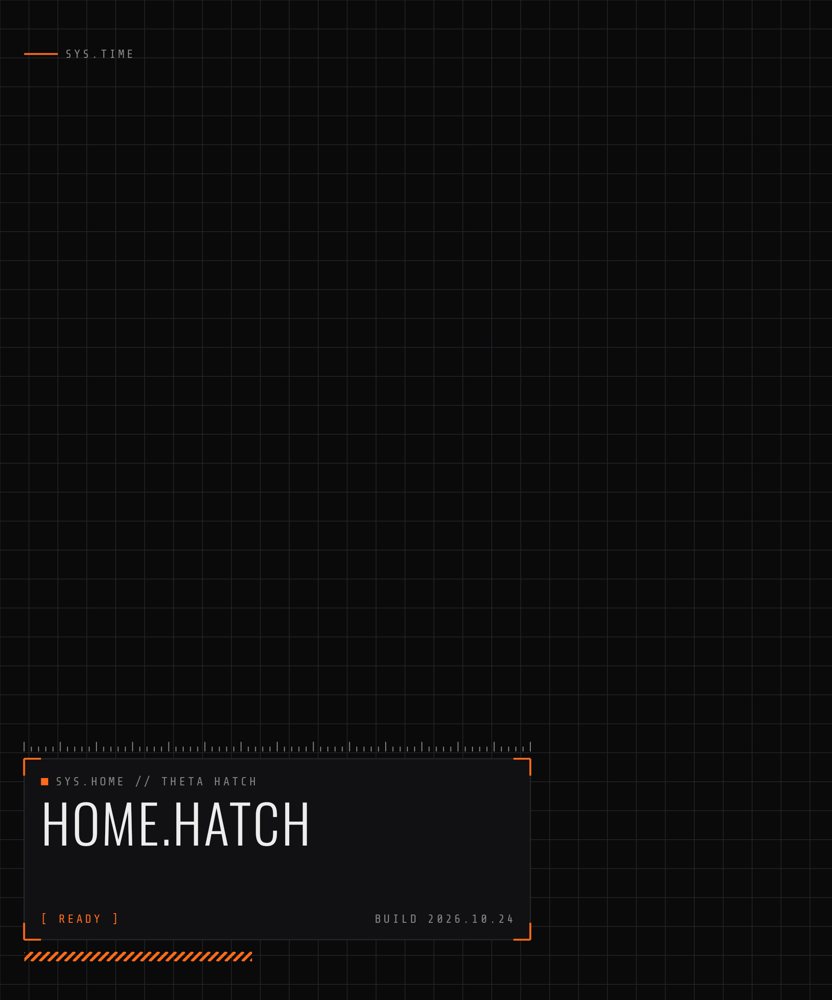

# One UI（Galaxy）の見た目を Theta Home Hatch に合わせる

One UI のテーマ（Galaxy Themes で配るもの）は Samsung の審査が要るので、ファイルとしては作れません。
代わりに、One UI の機能で自分で組める範囲で、HUD（黒地にオレンジ）に寄せます。

## 1. 壁紙を HUD にする（いちばん効く）

Theta Home Hatch の **設定 → ONE UI →「壁紙を HUD に（ダーク）」**。ホームとロック画面の両方に設定し、写真の `Pictures/ThetaHomeHatch/Wallpaper` にも保存します。
Fold5 は**閉じた画面と開いた画面でそれぞれ押してください**（縦横が違うので、そのときの画面の大きさで作ります）。

One UI 8 は壁紙から色を取ってシステムの色を決めるので、これだけでクイックパネル・設定・キーボード・通知などが黒とオレンジ寄りになります。

- 設定 → 壁紙とスタイル → **カラーパレット**で、壁紙から取った色（オレンジ系）を選ぶ
- 設定 → ディスプレイ → **ダークモード**をオン

ここにある PNG（`wallpaper-fold5-*.png`）を直接使ってもかまいません。

| 閉じた画面（ダーク） | 開いた画面（ダーク） |
| --- | --- |
|  |  |

## 2. アイコン（Good Lock の Theme Park）

Theta Home Hatch の **設定 → ONE UI →「アイコンを PNG で書き出す」**。今の 3 色・配色で、全アプリのアイコンを `Pictures/ThetaHomeHatch/Icons-日付` に `アプリ名.png` で保存します。

Galaxy Store から **Good Lock** を入れ、その中の **Theme Park** で：

1. アイコン → 新しく作る（アイコンのテーマを作る）
2. 形は**四角**、地の色は `#19191C`（ダーク）、大きさは大きめに
3. アプリごとのアイコンを変えるところで、書き出した PNG を選ぶ（よく使うアプリから）
4. 保存して適用

One UI ホームとアプリ一覧に加えて、システムの一部の画面にも出ます（どこまで効くかは One UI の版によります）。

## 3. Theme Park のテーマ（色）を作るなら

Theme Park の「テーマ」で、HUD の壁紙を選ぶと色が自動で取られます。手で直すときの色：

| 使いどころ | 色 |
| --- | --- |
| 地 | `#0A0A0B` |
| 面（パネル） | `#111113` / `#19191C` |
| 文字 | `#EDEDED` |
| 補足の文字 | `#A3A3A3` |
| 線 | `#333336` |
| アクセント（オレンジ） | `#FF6B1A` |

ライトにするなら：地 `#F4F3EE`、文字 `#121212`、アクセント `#B8400C`。
